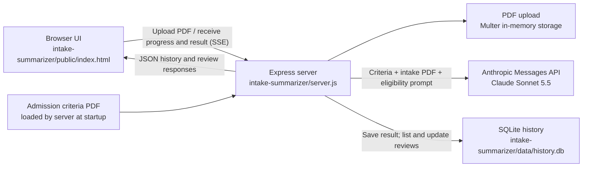

# Helping Hands

Helping Hands is a recuperative-care eligibility checker. A user uploads a patient intake/referral PDF, and the application compares it with the program's admission criteria to produce an eligibility determination with supporting criteria and follow-up questions. Reviewers can record whether they approve or disapprove each result.

## Architecture



The Express server serves the browser interface from `intake-summarizer/public/`. For an eligibility check, Multer accepts one PDF (up to 20 MB) in memory. The server sends that intake PDF and the bundled admission-criteria PDF to Anthropic with instructions to return structured JSON. The result is streamed to the browser as server-sent events and saved in SQLite. The app retains the 100 most recent results, including the determination, summary, criteria, and any reviewer decision.

The uploaded PDF is sent to the Anthropic API for analysis. The application does not save the original upload in its local history database.

## Project structure

| Path | Purpose |
| --- | --- |
| `intake-summarizer/server.js` | Express app, PDF upload handling, Anthropic request, and API routes |
| `intake-summarizer/public/index.html` | Browser interface for checking eligibility and reviewing history |
| `intake-summarizer/db.js` | SQLite schema and history/review operations |
| `intake-summarizer/ihh-recuperative-care-admission-criteria.pdf` | Criteria document sent with each intake for evaluation |
| `intake-summarizer/data/history.db` | Runtime-created local history database |
| `ihh-*.pdf`, `R01.pdf`, `R02.pdf` | Additional project reference documents |

## Run locally

Requirements: Node.js 22.5 or later and an Anthropic API key.

```sh
cd intake-summarizer
npm install
export ANTHROPIC_API_KEY="your-api-key"
npm start
```

Open [http://localhost:3000](http://localhost:3000). The server exits at startup if `ANTHROPIC_API_KEY` is missing or the bundled admission-criteria PDF cannot be found.

## API

- `POST /api/summarize` — accepts a multipart form upload with a `file` field; streams progress, the completed result, or an error as server-sent events.
- `GET /api/history` — returns saved eligibility checks.
- `POST /api/history/:id/review` — records an `approved` or `disapproved` reviewer decision.

## Hackathon participants

- Jonathan
- Raghunath
- Raghavendra
